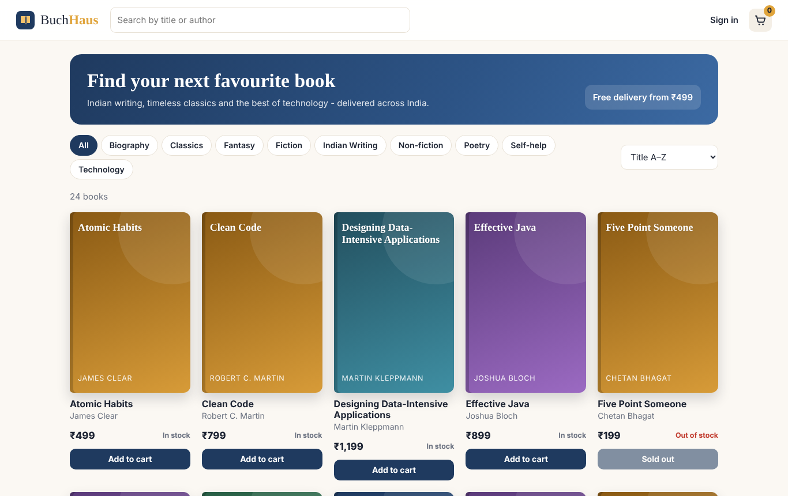
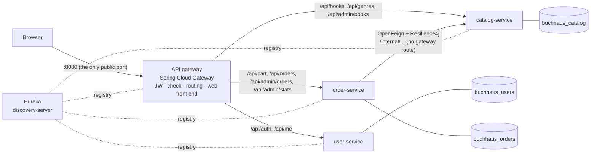
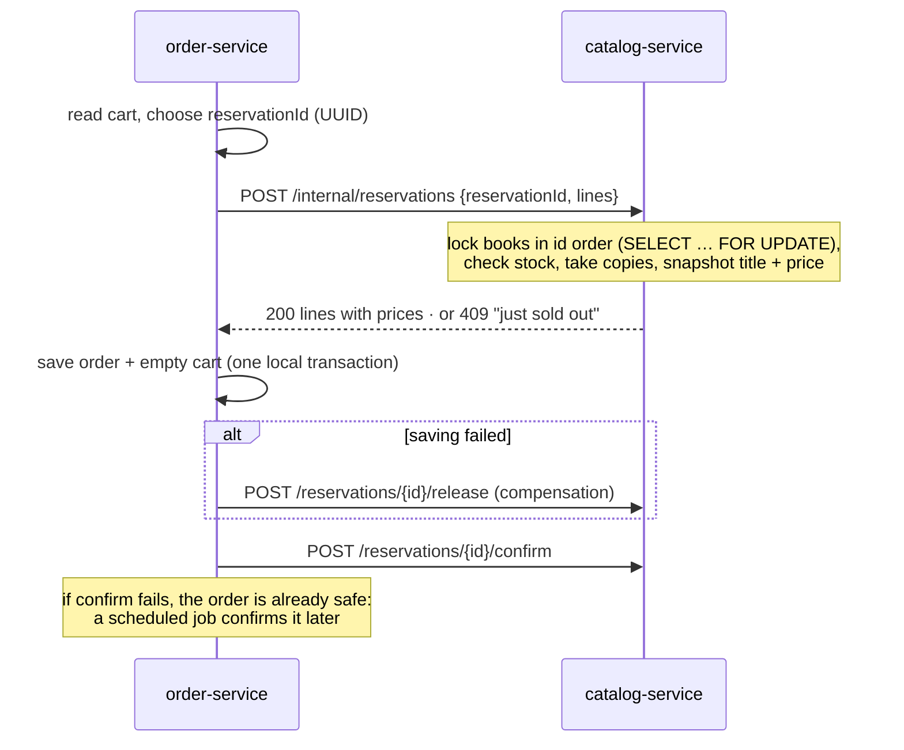
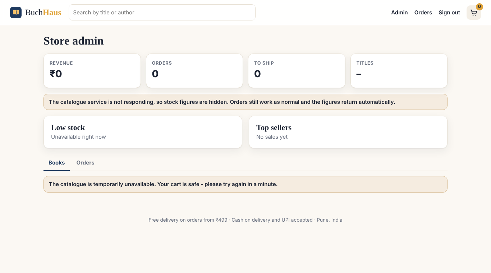

# BuchHaus Microservices

The [BuchHaus](https://github.com/pallavipatil1111/buchhaus) online bookstore, split from one Spring Boot application into **independent services**. They sit behind a **Spring Cloud Gateway** and find each other through **Eureka service discovery**. Each service has its own MySQL database.

The browser still talks to the same API as before, so the web front end did not change.

**Stack:** Java 21, Spring Boot 3, Spring Cloud 2024 (Gateway, Netflix Eureka, OpenFeign, LoadBalancer), Resilience4j (circuit breaker, retry), Spring Data JPA, Flyway, MySQL 8, JWT, Docker Compose.

**Tests:**
- 55 JUnit tests: unit tests, plus each service's API tested on H2 and on real MySQL.
- 8 Playwright end-to-end tests against the full Docker Compose stack.
- A **resilience test** that stops the catalogue service mid-run and checks that the system degrades gracefully and recovers.
- GitHub Actions runs all of these.



---

## Architecture



| Module | What it owns | Notes |
|---|---|---|
| `api-gateway` | Nothing stored | Verifies JWTs, enforces public / signed-in / admin rules, strips client-sent identity headers, forwards `X-User-Id/Email/Role`, serves the web front end |
| `discovery-server` | Service registry | Eureka; every service registers and is looked up by name (`lb://catalog-service`) |
| `user-service` | Accounts | Registration, login (BCrypt), issues HS256 JWTs. The only service that ever sees a password |
| `catalog-service` | Books, stock, reservations | Search, admin title management, stock reservations with row locks |
| `order-service` | Carts, orders | Cart, checkout saga, order life cycle, admin dashboard |
| `common` | Shared library | JWT codec, caller headers, money in paise, one JSON error format |

**Each service has its own database.** In Docker Compose, one MySQL server holds three databases, with three users that can each only see their own. There are no foreign keys between services. Orders keep `user_id` and `book_id` as plain values, with title and price **snapshots** taken at checkout.

## How checkout works across two services (a saga)

A single database transaction can't span two services, so checkout is a **saga**: local steps with a compensating action for each.



**Every call to the catalogue is idempotent.** The order-service chooses the reservation id *before* calling, so a retry finds the same reservation instead of taking the copies twice. Releasing twice or confirming twice does nothing the second time.

**Cancelling** releases the reservation first and only then marks the order cancelled. If the catalogue is down, the order stays as it was and the customer gets a clear 503. Because release is idempotent, cancelling again never restocks twice.

**Nothing is left stuck:**
- If the order-service crashes between reserve and confirm, the catalogue's `ReservationSweeper` releases reservations that stay unconfirmed for 30 minutes.
- If the catalogue is down when an order is confirmed, the order-service's `ConfirmRetrier` confirms it once the catalogue is back.

## Resilience

The order-service calls the catalogue through an **OpenFeign** client wrapped in **Resilience4j** ([`CatalogGateway`](order-service/src/main/java/com/buchhaus/order/catalog/CatalogGateway.java)):

| Mechanism | Setting | Why |
|---|---|---|
| Timeouts | 2 s connect, 3 s read | A slow catalogue can't hold order-service threads forever |
| Retry | 3 attempts, exponential backoff (200 ms, 400 ms) | Rides out a restart or a lost packet. Safe only because the calls are idempotent |
| Circuit breaker | Opens when 50% of the last 10 calls fail; stays open 10 s, then lets 2 calls through to test | Stops hammering a dead service and fails fast |
| Business errors pass through | 4xx (sold out, unknown book) is neither retried nor counted as a failure | "Sold out" is an answer, not an outage |

**What the user sees when the catalogue is down:**
- **Checkout:** returns *503 "The catalogue is temporarily unavailable. Your cart is safe - please try again in a minute."*
- **Order history:** still works, because it lives entirely in the order-service.
- **Admin dashboard:** still loads, showing order figures with a notice in place of the stock figures.



[`scripts/resilience-test.sh`](scripts/resilience-test.sh) proves this in CI. It stops the `catalog-service` container, checks each behaviour above, and starts it again. Then it checks that checkout recovers on its own: Eureka re-registration and the breaker closing need no restart of the other services.

## Security at the edge

- **The gateway is the only public entry point.** The services and MySQL have no published ports.
- **The gateway checks every JWT** (signature, issuer, expiry) and applies [`AccessPolicy`](api-gateway/src/main/java/com/buchhaus/gateway/AccessPolicy.java):
  - public: browsing books and genres, signing in
  - signed in: cart, orders, profile
  - admin: everything under `/api/admin`
- **The gateway removes client-sent `X-User-*` headers and the token itself**, then adds its own. So a customer can't become an admin by sending `X-User-Role: ADMIN`; an end-to-end test checks exactly that.
- **Admin endpoints check the role again** inside the service (defence in depth).
- **The internal API (`/internal/**`) has no gateway route**, so it can't be reached from outside.
- **Ambiguous paths are rejected with 400 before routing:** dot segments, encoded characters, `//` and `;`.

## Running it

```bash
cp .env.example .env              # set JWT_SECRET, ADMIN_PASSWORD and the database passwords
docker compose up --build         # 6 containers; first build takes a few minutes
```

- http://localhost:8080: the shop (through the gateway)
- http://localhost:8761: the Eureka dashboard, which shows every registered service

| Account | Email | Password |
|---|---|---|
| Admin | admin@buchhaus.local | Admin@12345 |
| Demo customer | reader@buchhaus.local | reader1234 |

To see the resilience behaviour yourself:

```bash
docker compose stop catalog-service    # try to check out, open the admin page
docker compose start catalog-service   # everything recovers within about 30 seconds
```

Each service can also run on its own with H2 (`mvn -pl catalog-service spring-boot:run`). It then expects Eureka on `localhost:8761`, or set `eureka.client.enabled=false`.

## Tests

```bash
mvn verify                                             # 55 JUnit tests across all modules
docker compose up -d --build --wait && scripts/wait-for-stack.sh
cd e2e && npm install && npx playwright install chromium
BASE_URL=http://localhost:8080 npx playwright test     # 8 end-to-end tests through the gateway
cd .. && scripts/resilience-test.sh                    # stop / start the catalogue
```

| Area | Tests | What is covered |
|---|---|---|
| `common` | 8 | JWT round trip, expiry, tampering, wrong key, short secrets; admin check; paise maths |
| Gateway | 5 | Public, signed-in and admin rules; forged paths (`..`, `%2e`, `//`, `;`); bearer parsing |
| Catalogue | 16 | Reserve snapshots prices; **retried reserve takes stock once**; sold out reserves nothing; last copy reserved once; release restocks exactly once; confirm rules; abandoned reservations swept; retire vs delete; **4 threads racing for the last copy over HTTP** (H2 and MySQL) |
| Orders | 19 | Saga happy path; sold out saves nothing; **failed save releases the reservation**; catalogue down gives a 503 and keeps the cart; **failed confirm is retried later**; cancel releases first; no cancel while the catalogue is down; ownership; state machine; cart stock limits; deleted books leave the cart; admin dashboard without the catalogue; error translation; HTTP contract with the gateway headers |
| Users | 7 | Registration, login, seeded accounts, one generic login error, `/api/me` from the gateway header, validation |
| End to end (Playwright) | 8 | Catalogue, registration, cart → checkout → cancel across services, admin dashboard; 401 without a token; **forged identity headers ignored**; internal API unreachable; path tricks refused; **two customers racing for the last copy through the whole stack** |
| Resilience script | 1 run | Catalogue stopped: checkout 503, dashboard degraded, order history fine; catalogue started: checkout recovers |

CI (`.github/workflows/ci.yml`) has three jobs:
- all JUnit tests on H2
- each service's API tests on MySQL 8, with a separate database per service
- the full Docker Compose stack, with Playwright and the resilience test
